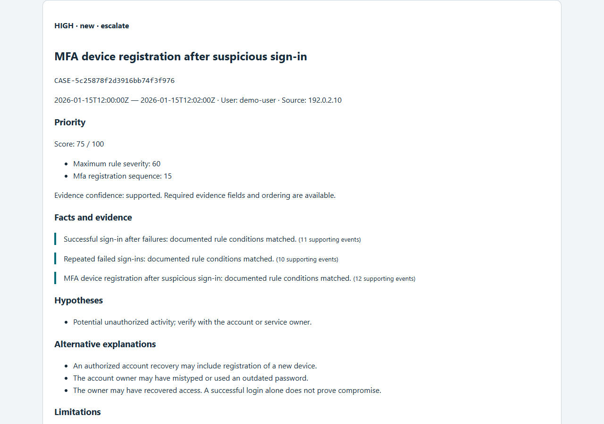

# Log Incident Analyzer

An offline SOC L1 investigation tool: turn application and web logs into explainable cases, linked evidence and a telemetry readiness report.

**Version 0.1.0.** Working Python CLI, SQLite storage and static HTML/Markdown/JSON reports. This repository includes the implementation, tests, reproducible datasets and measured validation results. Full specification acceptance remains conditional on the outstanding gates listed in [VALIDATION.md](docs/VALIDATION.md).

[Русский старт](START_HERE_RU.md) · [Purpose](#why-this-project-exists) · [Features](#what-works-today) · [Demo](#try-it) · [Errors](#common-errors-and-what-to-do) · [Test results](#verified-results) · [Known limits](#known-limitations-and-next-steps)

## Why this project exists

A suspicious log entry rarely answers an analyst's real questions: what happened before it, whether the events belong to the same account, how urgent it is, and which evidence supports escalation. Manually joining exports also makes it easy to miss malformed records, assume an order the timestamps cannot establish, or count repeated copies as separate activity.

Log Incident Analyzer implements a small SOC L1 investigation workflow: **import → check telemetry → detect behavior → assemble a case → review evidence → record a decision**. It is intended for SOC learners, detection engineers testing rules, and analysts examining completed application or nginx exports locally.

| Problem | What the project does |
|---|---|
| Related events are scattered across files | Normalizes supported exports, preserves source references and links related alerts into cases. |
| Several alerts can describe one incident | Connects failed logins, a later successful login and same-session MFA enrollment when the required evidence exists. |
| No alerts can mean missing telemetry | Reports rule readiness and missing fields alongside findings. |
| Priorities are difficult to justify | Shows rule severity, contextual score changes, facts, alternative explanations and suggested next checks. |
| Broken records or repeated exports can distort results | Quarantines invalid records with reason codes, deduplicates events and reports input accounting. |
| A portfolio claim is hard to verify | Includes frozen datasets, executable tests, measured results and an explicit list of unverified requirements. |

The output supports an analyst's decision. A rule match alone does not establish that an account was compromised.

## What works today

| Area | Implemented behavior |
|---|---|
| Input | Three explicit formats: application audit JSONL, nested nginx JSONL and nginx combined; optional single-stream gzip. |
| Normalization | UTC timestamps, timezone and precision checks, tenant/application boundaries, trusted-proxy handling, deduplication and source provenance. |
| Detection | Eight configurable detectors, time windows and evidence-linked sequences; validated custom rule DSL `lia-rule/v1`. |
| Triage | Cases, transparent scores, scoped expiring critical-asset/approval/NAT/suppression context, analyst notes and status history. |
| Investigation | Event evidence, qualified MITRE ATT&CK candidates, alternative explanations and telemetry quality reports. |
| Storage and reports | Private SQLite plus JSON, Markdown and offline HTML; escaped report content and pseudonymized shareable exports. |
| Reliability | One writer per workspace, staged publication, resource limits and recovery of interrupted case-review publication. |
| Evaluation | Scenario replay, comparison, benchmarking, reproducible lab captures and test-to-specification traceability. |

The architecture and data flow are described in [Architecture](docs/ARCHITECTURE.md). Operational and privacy boundaries are documented in [Security](SECURITY.md).

## Try it

Python 3.12 or 3.13 and `uv`:

```sh
uv sync --locked --group dev
uv run lia demo --output reports/demo
```

Open `reports/demo/report.html`. The demonstration produces **3 alerts, 1 case, priority high, score 75** from a failed-login → successful-login → MFA-registration sequence. Every finding links to the events that support it. HTML works offline and contains no JavaScript.



Two further stories show how the conclusion changes:

```sh
uv run lia demo --variant recovery --output reports/recovery
uv run lia demo --variant incomplete --output reports/incomplete
```

An independently recorded recovery approval reduces priority but leaves the high-risk chain visible. Missing session telemetry prevents the MFA chain from being asserted.

For a wheel installation without the development environment:

```sh
python -m pip install --require-hashes -r requirements.lock.txt
python -m pip install --no-deps dist/log_incident_analyzer-0.1.0-py3-none-any.whl
lia demo --output reports/installed-demo
```

Build that wheel with `uv build` first. Commands require a **new output directory**; existing results are not overwritten.

## Design choices that distinguish the project

- **Evidence before conclusions.** Facts, hypotheses, alternative explanations and next checks appear separately. A rule match does not establish compromise.
- **Time semantics are tested.** UTC microseconds, `(t-W, t]` windows, clock uncertainty, timestamp precision, DST ambiguity and deterministic arrival-order handling.
- **Data gaps are visible.** Each rule reports candidate and eligible events, missing fields and readiness. A quiet log is not treated as evidence of safety.
- **Triage is explainable.** Same-tenant/application identity boundaries, explicit sequence links, scoped expiring context and a published scoring policy.
- **Evaluation includes inconvenient negatives.** The independent v2 suite contains 40 attack and 80 benign episodes, including benign behavior that correctly triggers a rule. Six HTTP lab workflows complement synthetic data.
- **Checks cover failures.** Property tests, hostile input, interrupted writes, CLI contracts, wheel installation and six deliberate code mutations are included.

## Detectors

| ID | Observable behavior | Default condition |
|---|---|---|
| DET-001 | Repeated failed login | 10 failures / user + IP / 5 minutes |
| DET-002 | Many accounts tried from one source | 10 distinct users / IP / 10 minutes |
| DET-003 | Successful login after failed-login burst | DET-001 followed by success / same user + IP / 10 minutes |
| DET-004 | Failures across multiple source addresses | 20 failures + 5 IPs / user / 10 minutes |
| DET-005 | Repeated MFA challenges | 5 distinct challenge IDs / user / 5 minutes |
| DET-006 | MFA registration after suspicious login | DET-003 → self-enrollment / same session / 15 minutes |
| DET-007 | Requests for sensitive paths | 5 distinct configured paths / IP / 10 minutes |
| DET-008 | Repeated authorization denials | 10 explicit denials + 3 resources / user / 5 minutes |

Every group also includes tenant and application. ATT&CK mappings are evidence-qualified candidates; MFA-device registration mapping requires an identity-provider source. OWASP informs the logging contract and limitations; the tool does not issue OWASP compliance claims. See [sources and mapping](docs/SOURCES.md).

## Analyze your own export

Start with [examples/input/manifest.yml](examples/input/manifest.yml), [app-audit-v1.jsonl](examples/input/app-audit-v1.jsonl) and [config.yml](examples/config.yml). Supported formats: `app-audit-v1`, `nginx-json-v1`, `nginx-combined-v1`, optionally one gzip stream.

```sh
uv run lia validate-config --config examples/config.yml
uv run lia validate-rules
uv run lia analyze --manifest examples/input/manifest.yml --config examples/config.yml --output reports/example --formats json,markdown,html
uv run lia quality --run reports/example
```

Outputs: `analysis.json`, `analysis.sqlite`, `quality.json`, `run.json` and selected human-readable reports. `--shareable` pseudonymizes structured identities and omits the private database. Review source-specific free text before publishing any real dataset.

Case review, configuration, exit codes and recovery: [Operations](docs/OPERATIONS.md). Rule authoring and normalization contracts: [Architecture](docs/ARCHITECTURE.md). Trust boundaries: [Security](SECURITY.md).

### A typical analyst workflow

1. Validate the manifest/configuration and analyze a completed export into a new run directory.
2. Read `quality.json` or run `lia quality` to check which detectors had enough telemetry.
3. Open the HTML report, select a case and follow its evidence back to the source events. Check alternative explanations, such as shared NAT or an approved recovery.
4. Use `lia explain` for the case details, then `lia case set-status` and `lia case add-note` to record review or escalation.
5. Close the case with a verdict and reason, or leave it for further investigation. Preserve the private run as the investigation record.

Exact review commands and valid transitions are in [Operations](docs/OPERATIONS.md). Analyst notes do not become detector evidence.

## Common errors and what to do

Invalid records are counted and quarantined with reason codes; valid records can still be analyzed. Fatal storage, resource or input-stream errors stop the run and leave failure metadata. Check the exit code, `run.json` and the quality report before interpreting results.

| Error or symptom | Meaning and next action |
|---|---|
| `existing_output` / `unsafe_or_existing_output` | The destination already exists or is unsuitable. Choose a fresh output directory. |
| Invalid manifest, config or rule; exit `2` | Correct the indicated schema/validation error. Run `validate-config` and `validate-rules` before analysis. |
| `timezone_required` | A timestamp has no offset and its source has no timezone. Configure the source timezone or export offset-aware timestamps. |
| `ambiguous_time` / `nonexistent_time` | A local timestamp is ambiguous or impossible at a daylight-saving transition. Correct the export with an explicit offset; the tool does not guess. |
| `line_too_large` | A record exceeds the input line limit. Check the exporter and configured limits. |
| `truncated_gzip` / `multiple_gzip_members` | The gzip input is incomplete or contains multiple streams. Supply a complete single-stream export. |
| `workspace_busy` | Another writer holds the workspace lock. Wait for it; after a crash, verify the recorded PID has stopped before manually removing that specific stale lock. |
| `active_group_limit` / `workspace_size_limit` | A configured resource limit was reached. Narrow the input scope or review capacity and limits before retrying in a new directory. |
| Exit `3` or a detector is not ready | Inspect rejected records and missing telemetry. Add the required audit fields; an access-log status alone cannot prove login success. |
| A benign episode creates an alert | Review the evidence and context. A threshold match can be valid even when the activity is legitimate; record the verdict and tune only with supporting evidence. |

Exit codes: **0** completed, **2** invalid input/configuration/invocation, **3** partial/incomplete analysis or failed replay expectations, **4** I/O/storage/resource failure, **10** alerts found with `--fail-on-alert`, **130** interrupted. Import warnings take precedence over `--fail-on-alert`. See [Operations](docs/OPERATIONS.md) for recovery details.

## Verified results

Recorded on **2026-09-27**, Windows 11, Python 3.12.14 and 3.13.15. Counts below describe executed checks; the full report and machine-readable evidence are in [Validation](docs/VALIDATION.md).

| Check | Recorded result |
|---|---|
| Python 3.12, combined functional and acceptance checks | **326 passed, 0 failed, 2 skipped** |
| Python 3.13, functional/security checks | **322 passed** |
| Branch coverage | **90.79%** overall; normalization/time 98.57%, rules 100%, detection 94.92%, triage 94.83% |
| Deliberate code mutations | **6/6 detected by tests** |
| Scenario replay | **48/48** development and **120/120** independent v2 contract expectations passed |
| Captured HTTP workflows | **6/6 passed** |
| Packaging and reports | Clean wheel install, extracted-archive demo and desktop/mobile HTML smoke checks passed |
| Code and dependency checks | Ruff, formatting and mypy passed; dependency audit reported no known vulnerabilities at check time |
| Specification traceability | All **256** case IDs mapped; **253** passed locally; PERF-001, PERF-002 and SEC-020 remain unaccepted |

The independent v2 evaluation contains 40 attack and 80 benign episodes. Its primary decision metric recorded **TP 40, FP 4, FN 0, TN 76**: precision **90.91%**, recall **100%**. Passing all replay expectations includes expected false positives; it does not mean perfect detection. Auxiliary alerts are outside that primary metric. These are project-authored controlled scenarios, not field accuracy estimates; see [Datasets and evaluation](docs/DATASETS.md).

### Measured performance

Each workload used one warmup and five measurements on a Windows host with 12 logical CPUs and approximately 16 GiB RAM. Input generation was excluded; parsing through JSON/Markdown report generation was included. Background load and OS cache were not isolated.

| Input records | Median elapsed time | Slowest run | Peak RSS |
|---|---:|---:|---:|
| 100,000 | **16.27 s** | 34.50 s | 325.5 MiB |
| 1,000,000 | **271.51 s** | 279.88 s | 505.5 MiB |

The million-record run **did not meet 180 seconds on this Windows host**. The specified Linux 4 vCPU / 8 GiB / SSD acceptance environment has not been tested. Memory, disk and record-accounting checks passed; each million-record run accepted 990,000 events and quarantined the 10,000 deliberately malformed records. See [Validation](docs/VALIDATION.md) for methodology and recorded runs.

## Reproduce the checks

```sh
uv run ruff check src tests tools
uv run ruff format --check src tests tools
uv run mypy src
uv run pytest -m "not performance and not delivery" --cov=lia --cov-report=json:reports/coverage.json
uv run python tools/coverage_gate.py reports/coverage.json
uv run python tools/mutation_check.py
uv run lia replay --suite datasets/evaluation-v2/manifest.yml --output reports/evaluation-v2
uv run python tools/capture_lab.py --output reports/lab
uv build
uv run python tools/wheel_smoke.py
uv run pip-audit --skip-editable
```

Dedicated performance runs:

```sh
uv run lia benchmark --profile benchmarks/standard.yml --output reports/performance/benchmark-100k-final
uv run lia benchmark --profile benchmarks/million.yml --output reports/performance/benchmark-million-final
```

Each standard run has one warmup and five measurements. Generating the input is outside the timer; parsing, normalization, SQLite, detection and JSON/Markdown export are inside it. See [validation](docs/VALIDATION.md) for actual results and the fixed Linux acceptance requirements.

The [CI workflow](.github/workflows/ci.yml) defines Windows/Linux × Python 3.12/3.13 checks and an offline, read-only, non-root Docker smoke test. A workflow definition is not evidence that a hosted run has passed.

## Known limitations and next steps

| Status | Limitation or remaining work |
|---|---|
| Unverified | Execute the Linux Python matrix and the Docker security smoke test. Their CI jobs exist, but no hosted passing run is claimed. |
| Acceptance incomplete | Measure both performance profiles on the specified Linux runner. The 180-second million-record target was missed on the current Windows host. |
| Evaluation limit | Add external blind validation and investigate the observed benign alerts before claiming general detection quality. |
| Recovery limit | Abrupt termination can leave a stale writer lock or an orphan review stage that requires manual verification and cleanup. Direct file readers can see an older report while an update is being published. |
| Privacy limit | Shareable mode pseudonymizes structured fields; arbitrary source text still requires review before publication. |
| Mapping limit | ATT&CK uses a reviewed technique allowlist, not the complete STIX catalog. OWASP guidance is used for telemetry design; compliance and percentage-of-ATT&CK-coverage claims are outside scope. |

This is a **single-user batch analyzer for completed exports**. Live collection, multi-user access, a web dashboard, SIEM ingestion, streaming resume, automatic remediation, reputation lookups and LLM integration are outside version 0.1.0. Its bounded rule DSL is not Sigma-compatible. A shared IP is not proof of a shared attacker; HTTP status alone is not an authentication outcome.

Default resource limits include 256 KiB per line, 100 input files, 2 GiB input, 100,000 active groups and a 16 GiB workspace. These are configurable safety bounds, not promises that every workload below them meets a performance target.

The original Russian [specification](docs/TECHNICAL_SPECIFICATION.md), [test catalog](docs/TEST_PLAN.md), [design decisions](docs/ADR.md) and [acceptance status](docs/VALIDATION.md) explain the contract and remaining limitations.

MIT license. Original detector implementation; references and dependency licenses are listed in [THIRD_PARTY_NOTICES.md](THIRD_PARTY_NOTICES.md).
